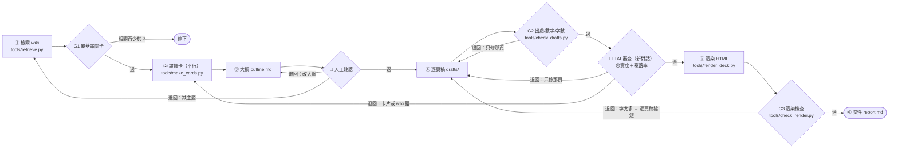

# Workflow：/topic-slides —— 用 wiki 產生教學 HTML 簡報（Graph 版）

## 五件事（講義 p.20）
| | |
|---|---|
| 🎯 目標 | 只用 `wiki/` 的內容，產出給「完全沒學過的同學」看的教學 HTML 簡報 `topic-*/deck.html` |
| 🚧 限制 | 不得使用 wiki 以外的知識；每一關只能讀「上一關的產出」（見下表）；渲染不得改字 |
| ✅ 完成標準 | 所有程式檢查（G1–G4）全過＋AI 審查無「錯誤」級問題，產出 `report.md` |
| 🛑 停止條件 | ① 全過 → 交件；② 任一節點的小 loop 改滿上限（逐頁稿 2 輪、渲染 2 輪、全域 3 輪）→ 停下附報告交人處理；③ 檢索後相關頁 < 3 → 一開始就停 |
| ⏰ 觸發 | 使用者說「/topic-slides <主題>」；或 wiki 有新 ingest 後重跑 |

## Graph

## 每一關只能看什麼、不能做什麼（講義 p.43）
| 節點 | 輸入（只能看） | 輸出 | 不能做 | 檢查 |
|---|---|---|---|---|
| ① 檢索 | `wiki/*.md`、主題關鍵字 | `sources.md` | 讀 raw、上網 | G1：相關頁 ≥ 3、必備概念都有頁 |
| ② 證據卡 | 一個 wiki 頁 | `cards/<頁名>.md` | 混用其他頁、改寫句子 | 卡片每句必須與 wiki 原句完全相同（G2 內含） |
| ③ 大綱 | `sources.md`、`cards/` | `outline.md` | 寫內文 | 👤 人工確認（教學順序、讀者程度） |
| ④ 逐頁稿 | `outline.md`＋該頁對應的卡 | `drafts/NN.md` | 引用卡片以外的內容 | G2：每頁有出處、`[card:]` 存在、數字在所引卡片中、8–15 頁、每頁字數上限 |
| AI 審查 | 逐頁稿＋所引卡片（**新對話**） | `checks/review-*.md` | 審自己的作品、動手改 | 忠實度（有沒有講反）、覆蓋率（必備概念） |
| ⑤ 渲染 | 已通過的 `drafts/` | `deck.html` | 改任何一個字（由腳本決定性渲染） | G3：每頁無溢出、稿件每句都原樣出現在 HTML、互動元件數字可追溯 |

## 錯在哪一關就退回哪一關（講義 p.44）
- 某頁講錯 → 只重寫那一頁（其他頁不動）
- 卡片本身錯 → 退回 ② 重抽那一頁的卡
- 字太多溢出 → 不硬塞、不縮字級，退回 ④ 縮短那一頁
- 看大綱時發現缺主題 → 退回 ① 補檢索（wiki 沒有就要先 ingest 新來源）

## 每格裡面還是 loop（講義 p.45）
- 逐頁稿節點：寫 → G2 → 修，最多 2 輪
- 渲染節點：產生 HTML → 截圖＋溢出檢查 → 縮短稿 → 再渲染，最多 2 輪

## 修訂紀錄（實際執行後）
| 發現 | 修改 | 為什麼 |
|---|---|---|
| 撰寫 wiki 時反覆把 two/one bit/May 寫成 2/1/5（lint L5 擋下 6 次） | AGENTS.md §4 新增「數字照抄來源寫法」 | 把檢查往前移到「撰寫規則」，在源頭就不犯 |
| AI 審查抓到的 3 個錯誤，2 個源頭在 wiki，不在簡報 | 新增退回路線「AI 審查 → wiki → 重抽那一張卡」 | 只修簡報會讓 wiki 繼續錯，下次產出又會錯 |
| 💡 行不受 lint 檢查，被拿來夾帶事實主張 | G2 規定 💡/@ 行不得含數字；wiki 的 💡 事實句改成有出處的一般行 | 堵住「標成比喻就免檢查」的漏洞 |
| G2 第一次 0 問題，無法判斷檢查是否有效 | 加「突變測試」：故意埋 6 種錯，確認 6/6 抓到 | 「全過」可能是檢查太鬆，要先證明檢查器會抓錯 |
| 一串指令裡 G2 失敗，渲染仍照跑 | 新增 `tools/run_graph.sh`（`set -e`） | 關卡要由結束碼強制擋下，不能靠人看輸出 |
| 第 13 頁字數超限，每次只刪幾個字，小修 4 次（超過上限 2 輪） | 縮短時一次刪掉與表格重複的整句 | 小圈轉太多次，代表修法太保守 |
